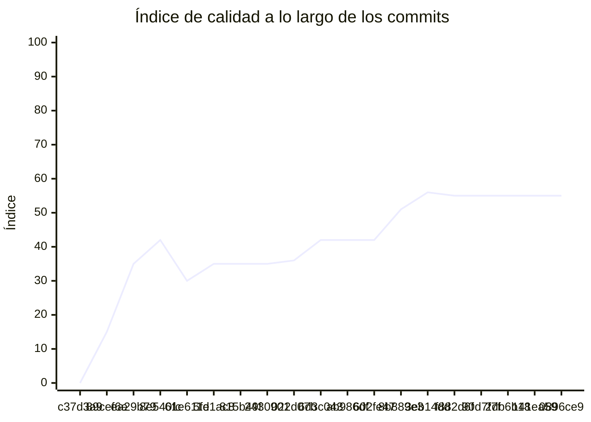

<!-- evaluacion:inicio -->
# Evaluación — mat-gomez/catalog-service

> Documento **generado automáticamente** por la cátedra de Programación II (UM): RepoSense + análisis de calidad de **7 dimensiones**. **No editar a mano**: se regenera en cada evaluación.
> Rama evaluada: `main`. Análisis **heurístico** (regex + métricas) + build: es una criba para orientar la revisión, **no una nota**. La **documentación** del repositorio no se evalúa.
> Generado: 2026-11-12.

## 1. Veredicto

| Aspecto | Resultado |
|---|---|
| Índice de calidad | **66/100** |
| Tipo de repositorio | `backend` |
| Build (`mvnw verify` / `gradlew check`) | OK |
| Código (LOC) | 2,889 |
| Archivos de código | 78 |
| Clases | 78 |
| Código dentro de clases (%POO) | 78% |
| Funciones fuera de clases | 0 |
| Duplicación (puerta) | 3.9% |
| Duplicación lógica | 4.3% |
| Duplicación de boilerplate | 5.1% |
| Cobertura | 96% |
| Tope duro aplicado a D1 | `POO_BAJO` → D1 ≤ 60 |

> Este informe **describe** lo que el análisis midió con los criterios ya establecidos de la materia. No es una nota.

## 2. Semáforo de aprobación

Criterios de la cátedra (`CRITERIOS-CALIDAD.md`): **Aprobar** se juega con el perfil `estandar`; **destacar**, con el `exigente` (meta de excelencia).

| Semáforo | Resultado |
|---|---|
| Aprobar (`estandar`) | **no cumple** — 5/11 |
| Destacar (`exigente`) | **no cumple** — 4/11 |

**Para aprobar, falta cumplir:** SOLID; Duplicación; SQL

**Para destacar, falta cumplir:** SOLID; POO; Duplicación; SQL

## 3. Autoría (RepoSense)

| Autor | Commits | Código (LOC) | Tests (LOC) | Docs (LOC) | Días activos | % del código |
|---|---:|---:|---:|---:|---:|---:|
| Melina Abril Gomez Torres | 62 | 1,029 | 1,443 | 122 | 15 | 100% |

> _El LOC de autoría lo calcula RepoSense sobre el historial y puede diferir del LOC de código del análisis (que mira el estado de `main`)._

## 4. Dimensiones evaluadas

Cada dimensión indica **qué mide**, **por qué importa** y **tu resultado**. Cuando el puntaje queda por debajo de la referencia, se agregan preguntas para **investigar la causa** (no hay recetas).

| Dimensión | Peso | Puntaje |
|:--|--:|--:|
| **D1** Diseño OO, SOLID y patrones (20%) | 20% | 6 |
| **D2** Arquitectura hexagonal — backend (15%) | 15% | 68 |
| **D3** Frontend KMP: MVVM y buenas prácticas (10%) | 10% | N/A |
| **D4** Integración y contrato (10%) | 10% | 60 |
| **D5** Seguridad y robustez (10%) | 10% | 70 |
| **D6** Pruebas y cobertura (20%) | 20% | 100 |
| **D7** Proceso y entrega (15%) | 15% | 100 |

### D1. Diseño OO, SOLID y patrones (20%)

- **Qué mide:** Métricas orientadas a objetos (clases, métodos, campos, cohesión, acoplamiento, herencia) y proxies de SOLID, más patrones de diseño.
- **Por qué importa:** El eje de la materia es el buen uso de la POO y su arquitectura: un diseño con clases claras y poco acopladas es más fácil de entender, probar y cambiar.
- **Tu resultado:** **6/100**
- **Para investigar la causa:**
    - ¿Se pensó el modelo de clases antes de codificar o se agrupó después?
    - ¿Qué clases concentran muchas responsabilidades a la vez?
    - ¿Los colaboradores llegan como parámetros o se crean por dentro?

### D2. Arquitectura hexagonal — backend (15%)

- **Qué mide:** Separación en capas (dominio, puertos de entrada/salida, adaptadores) y dirección de las dependencias del backend.
- **Por qué importa:** Aislar el dominio de la infraestructura permite cambiar la base de datos, el framework o el transporte sin tocar las reglas de negocio.
- **Tu resultado:** **68/100**

### D4. Integración y contrato (10%)

- **Qué mide:** Cumplimiento del contrato de integración de la cátedra (formato de errores, paginación, autenticación, endpoints esperados).
- **Por qué importa:** Los servicios deben poder integrarse entre sí y con la app sin sorpresas; el contrato es lo que hacen cumplir las pruebas de integración.
- **Tu resultado:** **60/100**

### D5. Seguridad y robustez (10%)

- **Qué mide:** Credenciales embebidas, consultas SQL por concatenación, y presencia de config de entorno; aislamiento de secretos.
- **Por qué importa:** Un secreto en el repositorio o una consulta construida por concatenación son riesgos concretos, no hipotéticos.
- **Tu resultado:** **70/100**

### D6. Pruebas y cobertura (20%)

- **Qué mide:** Cantidad y resultado de pruebas y cobertura de línea (JaCoCo/Kover, Surefire/Failsafe) cuando hay build.
- **Por qué importa:** Las pruebas son la red de seguridad para refactorizar e integrar; la cobertura acota las zonas sin verificar.
- **Tu resultado:** **100/100**

### D7. Proceso y entrega (15%)

- **Qué mide:** Artefactos verificables de proceso/entrega: `compose`, `.env.example`, CI (`.github/workflows/`), `CODEOWNERS` y wrapper de build (`mvnw`/`gradlew`). **No** puntúa documentación.
- **Por qué importa:** Un proyecto que compila, se levanta y se valida solo es más fácil de revisar y de integrar en equipo.
- **Tu resultado:** **100/100**

## 5. Señales detectadas

El análisis encontró las siguientes señales (archivo, sin número de línea a propósito):

**DIP/concretos** (20)
- clase 'CatalogServiceApplication' muy acoplada (CBO=14) — `src/main/java/ar/edu/um/catalog/CatalogServiceApplication.java`
- clase 'CatalogIncrementalSyncService' muy acoplada (CBO=35) — `src/main/java/ar/edu/um/catalog/service/CatalogIncrementalSyncService.java`
- clase 'CatalogIncrementalSyncService' instancia 5 concretos (CBO=35) — `src/main/java/ar/edu/um/catalog/service/CatalogIncrementalSyncService.java`
- clase 'CatalogSyncService' muy acoplada (CBO=19) — `src/main/java/ar/edu/um/catalog/service/CatalogSyncService.java`
- clase 'CatalogSyncService' instancia 4 concretos (CBO=19) — `src/main/java/ar/edu/um/catalog/service/CatalogSyncService.java`
- clase 'SecurityConfig' muy acoplada (CBO=25) — `src/main/java/ar/edu/um/catalog/config/SecurityConfig.java`
- clase 'SecurityConfig' instancia 3 concretos (CBO=25) — `src/main/java/ar/edu/um/catalog/config/SecurityConfig.java`
- clase 'ProfessionalRepository' muy acoplada (CBO=16) — `src/main/java/ar/edu/um/catalog/adapters/out/persistence/ProfessionalRepository.java`
- clase 'CatalogController' muy acoplada (CBO=13) — `src/main/java/ar/edu/um/catalog/adapters/in/rest/CatalogController.java`
- clase 'CatalogKafkaConsumer' muy acoplada (CBO=8) — `src/main/java/ar/edu/um/catalog/adapters/in/messaging/CatalogKafkaConsumer.java`
- clase 'CatalogControllerTest' muy acoplada (CBO=16) — `src/test/java/ar/edu/um/catalog/controller/CatalogControllerTest.java`
- clase 'CatalogControllerTest' instancia 3 concretos (CBO=16) — `src/test/java/ar/edu/um/catalog/controller/CatalogControllerTest.java`
- clase 'AplicarSnapshotCatalogoUseCaseTest' muy acoplada (CBO=8) — `src/test/java/ar/edu/um/catalog/service/AplicarSnapshotCatalogoUseCaseTest.java`
- clase 'CatalogIncrementalSyncServiceTest' muy acoplada (CBO=18) — `src/test/java/ar/edu/um/catalog/service/CatalogIncrementalSyncServiceTest.java`
- clase 'CatalogIncrementalSyncServiceTest' instancia 10 concretos (CBO=18) — `src/test/java/ar/edu/um/catalog/service/CatalogIncrementalSyncServiceTest.java`
- clase 'CatalogSyncServiceTest' muy acoplada (CBO=19) — `src/test/java/ar/edu/um/catalog/service/CatalogSyncServiceTest.java`
- clase 'ProfessionalRepositoryTest' muy acoplada (CBO=9) — `src/test/java/ar/edu/um/catalog/adapters/out/persistence/ProfessionalRepositoryTest.java`
- clase 'CatalogRepositoryTest' muy acoplada (CBO=10) — `src/test/java/ar/edu/um/catalog/adapters/out/persistence/CatalogRepositoryTest.java`
- clase 'CatalogRepositoryTest' instancia 3 concretos (CBO=10) — `src/test/java/ar/edu/um/catalog/adapters/out/persistence/CatalogRepositoryTest.java`
- clase 'EstadoSincronizacionControllerTest' muy acoplada (CBO=9) — `src/test/java/ar/edu/um/catalog/web/rest/EstadoSincronizacionControllerTest.java`

**SRP/responsabilidad** (31)
- clase 'CatalogIncrementalSyncService' grande (LOC=125, métodos=5, campos=8) — `src/main/java/ar/edu/um/catalog/service/CatalogIncrementalSyncService.java`
- método 'CatalogIncrementalSyncService.processCatalogUpdate' de 41 líneas — `src/main/java/ar/edu/um/catalog/service/CatalogIncrementalSyncService.java`
- método 'CatalogIncrementalSyncService.processCatalogUpdate' con complejidad 8 — `src/main/java/ar/edu/um/catalog/service/CatalogIncrementalSyncService.java`
- clase 'CatalogSyncService' grande (LOC=108, métodos=8, campos=21) — `src/main/java/ar/edu/um/catalog/service/CatalogSyncService.java`
- clase 'CatalogSyncService' con baja cohesión (32%) — `src/main/java/ar/edu/um/catalog/service/CatalogSyncService.java`
- método 'CatalogSyncService.processCategories' con complejidad 7 — `src/main/java/ar/edu/um/catalog/service/CatalogSyncService.java`
- método 'CatalogSyncService.processProfessionals' con complejidad 7 — `src/main/java/ar/edu/um/catalog/service/CatalogSyncService.java`
- método 'CatalogSyncService.processSchedules' con complejidad 7 — `src/main/java/ar/edu/um/catalog/service/CatalogSyncService.java`
- clase 'CambiosCatalogo' sin métodos (3 campos): solo datos — `src/main/java/ar/edu/um/catalog/domain/CambiosCatalogo.java`
- clase 'WeeklySchedule' grande (LOC=11, métodos=0, campos=9) — `src/main/java/ar/edu/um/catalog/domain/WeeklySchedule.java`
- clase 'WeeklySchedule' sin métodos (9 campos): solo datos — `src/main/java/ar/edu/um/catalog/domain/WeeklySchedule.java`
- clase 'EstadoSincronizacion' sin métodos (4 campos): solo datos — `src/main/java/ar/edu/um/catalog/domain/EstadoSincronizacion.java`
- clase 'ProfessionalCategory' sin métodos (6 campos): solo datos — `src/main/java/ar/edu/um/catalog/domain/ProfessionalCategory.java`
- clase 'Professional' sin métodos (7 campos): solo datos — `src/main/java/ar/edu/um/catalog/domain/Professional.java`
- clase 'SnapshotCatalogo' sin métodos (5 campos): solo datos — `src/main/java/ar/edu/um/catalog/domain/SnapshotCatalogo.java`
- clase 'CatalogSyncState' sin métodos (5 campos): solo datos — `src/main/java/ar/edu/um/catalog/domain/CatalogSyncState.java`
- clase 'CatalogSyncStateEntity' sin métodos (5 campos): solo datos — `src/main/java/ar/edu/um/catalog/adapters/out/persistence/CatalogSyncStateEntity.java`
- clase 'ProcessedKafkaEventEntity' sin métodos (3 campos): solo datos — `src/main/java/ar/edu/um/catalog/adapters/out/persistence/ProcessedKafkaEventEntity.java`
- clase 'ProfessionalCategoryEntity' sin métodos (6 campos): solo datos — `src/main/java/ar/edu/um/catalog/adapters/out/persistence/ProfessionalCategoryEntity.java`
- clase 'MensajeConsumidoEntity' sin métodos (4 campos): solo datos — `src/main/java/ar/edu/um/catalog/adapters/out/persistence/MensajeConsumidoEntity.java`
- clase 'WeeklyScheduleEntity' grande (LOC=18, métodos=0, campos=9) — `src/main/java/ar/edu/um/catalog/adapters/out/persistence/WeeklyScheduleEntity.java`
- clase 'WeeklyScheduleEntity' sin métodos (9 campos): solo datos — `src/main/java/ar/edu/um/catalog/adapters/out/persistence/WeeklyScheduleEntity.java`
- clase 'ProfessionalEntity' sin métodos (7 campos): solo datos — `src/main/java/ar/edu/um/catalog/adapters/out/persistence/ProfessionalEntity.java`
- clase 'EstadoSincronizacionResponse' sin métodos (4 campos): solo datos — `src/main/java/ar/edu/um/catalog/web/rest/dto/EstadoSincronizacionResponse.java`
- clase 'CatalogIncrementalSyncServiceTest' grande (LOC=142, métodos=10, campos=9) — `src/test/java/ar/edu/um/catalog/service/CatalogIncrementalSyncServiceTest.java`
- método 'CatalogIncrementalSyncServiceTest.testProcessCatalogUpdate_WithAllEntityMutations' con complejidad 8 — `src/test/java/ar/edu/um/catalog/service/CatalogIncrementalSyncServiceTest.java`
- método 'CatalogIncrementalSyncServiceTest.testProcessCatalogUpdate_EntityNotFoundInRedis' con complejidad 6 — `src/test/java/ar/edu/um/catalog/service/CatalogIncrementalSyncServiceTest.java`
- método 'CatalogIncrementalSyncServiceTest.testProcessCatalogUpdate_CatchExceptionDuringParsing' con complejidad 7 — `src/test/java/ar/edu/um/catalog/service/CatalogIncrementalSyncServiceTest.java`
- clase 'CatalogSyncServiceTest' grande (LOC=81, métodos=2, campos=9) — `src/test/java/ar/edu/um/catalog/service/CatalogSyncServiceTest.java`
- método 'CatalogSyncServiceTest.testExecuteFullSnapshotSyncSuccess' de 48 líneas — `src/test/java/ar/edu/um/catalog/service/CatalogSyncServiceTest.java`
- método 'ProfessionalRepositoryTest.setUp' de 36 líneas — `src/test/java/ar/edu/um/catalog/adapters/out/persistence/ProfessionalRepositoryTest.java`

**OCP/type-switch** (1)
- clase 'CatalogSyncService' con 6 type-checks — `src/main/java/ar/edu/um/catalog/service/CatalogSyncService.java`

**duplicación** (6)
- duplicación lógica: 3.9% · boilerplate: 5.1%
- bloque de 8 líneas repetido 4 veces en src/test/java/ar/edu/um/catalog/service/CatalogIncrementalSyncServiceTest.java:103, src/test/java/ar/edu/um/catalog/service/CatalogIncrementalSyncServiceTest.java:165, src/test/java/ar/edu/um/catalog/service/CatalogIncrementalSyncServiceTest.java:186 — `src/test/java/ar/edu/um/catalog/service/CatalogIncrementalSyncServiceTest.java`
- bloque de 8 líneas repetido 3 veces en src/main/java/ar/edu/um/catalog/service/CatalogIncrementalSyncService.java:108, src/main/java/ar/edu/um/catalog/service/CatalogIncrementalSyncService.java:129, src/main/java/ar/edu/um/catalog/service/CatalogIncrementalSyncService.java:150 — `src/main/java/ar/edu/um/catalog/service/CatalogIncrementalSyncService.java`
- bloque de 8 líneas repetido 3 veces en src/main/java/ar/edu/um/catalog/service/CatalogIncrementalSyncService.java:109, src/main/java/ar/edu/um/catalog/service/CatalogIncrementalSyncService.java:130, src/main/java/ar/edu/um/catalog/service/CatalogIncrementalSyncService.java:151 — `src/main/java/ar/edu/um/catalog/service/CatalogIncrementalSyncService.java`
- bloque de 8 líneas repetido 3 veces en src/main/java/ar/edu/um/catalog/service/CatalogIncrementalSyncService.java:107, src/main/java/ar/edu/um/catalog/service/CatalogIncrementalSyncService.java:128, src/main/java/ar/edu/um/catalog/service/CatalogIncrementalSyncService.java:149 — `src/main/java/ar/edu/um/catalog/service/CatalogIncrementalSyncService.java`
- bloque de 8 líneas repetido 2 veces en src/test/java/ar/edu/um/catalog/domain/model/ProfessionalTest.java:58, src/test/java/ar/edu/um/catalog/adapters/out/persistence/ProfessionalEntityTest.java:56 — `src/test/java/ar/edu/um/catalog/domain/model/ProfessionalTest.java`

**arquitectura** (1)
- consulta SQL construida por concatenación/interpolación — `src/main/java/ar/edu/um/catalog/adapters/out/persistence/ProfessionalRepository.java`

**hexagonal** (1)
- falta ports/out (hexagonal)

## 6. Evolución por commit

Métricas calculadas sobre el estado de `main` en **cada commit** (19 commits con trabajo), del primero al último. La calidad usa el perfil `exigente`; el aporte de código lo mide RepoSense. El índice puede **bajar** al crecer el proyecto: se acumulan señales.

| # | Fecha | Commit | Autor | LOC | Índice | %POO | Duplic. | Sueltas |
|---|---|---|---|---:|---:|---:|---:|---:|
| 1 | 2026-09-06 | `c37d3a9` | Melina Abril Gomez Torres | 0 | 0 | 0% | 0.0% | 0 |
| 2 | 2026-09-10 | `89cef6e` | Ing. Daniel Quinteros | 0 | 15 | 0% | 0.0% | 0 |
| 3 | 2026-10-15 | `ea29b79` | Melina Abril Gomez Torres | 18 | 35 | 56% | 0.0% | 0 |
| 4 | 2026-10-16 | `8e540fc` | Melina Abril Gomez Torres | 18 | 42 | 56% | 0.0% | 0 |
| 5 | 2026-10-18 | `61e611e` | Melina Abril Gomez Torres | 319 | 30 | 66% | 0.0% | 0 |
| 6 | 2026-10-18 | `5fd1ac8` | Melina Abril Gomez Torres | 319 | 35 | 66% | 0.0% | 0 |
| 7 | 2026-10-19 | `815b49f` | Melina Abril Gomez Torres | 319 | 35 | 65% | 0.0% | 0 |
| 8 | 2026-10-19 | `2430901` | Melina Abril Gomez Torres | 451 | 35 | 67% | 0.0% | 0 |
| 9 | 2026-10-22 | `022d07b` | Melina Abril Gomez Torres | 462 | 36 | 66% | 0.0% | 0 |
| 10 | 2026-10-25 | `6d3c043` | Melina Abril Gomez Torres | 582 | 42 | 65% | 0.0% | 0 |
| 11 | 2026-10-29 | `ab986df` | Melina Abril Gomez Torres | 721 | 42 | 65% | 0.0% | 0 |
| 12 | 2026-11-01 | `602fe47` | Melina Abril Gomez Torres | 582 | 42 | 65% | 0.0% | 0 |
| 13 | 2026-11-01 | `8b889e3` | Melina Abril Gomez Torres | 923 | 51 | 72% | 0.0% | 0 |
| 14 | 2026-11-02 | `3eb14dd` | Melina Abril Gomez Torres | 2,063 | 56 | 78% | 1.1% | 0 |
| 15 | 2026-11-02 | `f882d6f` | Melina Abril Gomez Torres | 2,431 | 55 | 77% | 0.9% | 0 |
| 16 | 2026-11-02 | `90d7f7f` | Melina Abril Gomez Torres | 2,628 | 55 | 79% | 4.3% | 0 |
| 17 | 2026-11-03 | `2db6b18` | Melina Abril Gomez Torres | 2,638 | 55 | 79% | 4.2% | 0 |
| 18 | 2026-11-03 | `141ea59` | Melina Abril Gomez Torres | 2,889 | 55 | 78% | 3.9% | 0 |
| 19 | 2026-11-03 | `0896ce9` | Melina Abril Gomez Torres | 2,889 | 55 | 78% | 3.9% | 0 |

---
_Informe generado por la cátedra. Las dimensiones y umbrales corresponden a `calidad.py` (perfil `exigente`); el semáforo, a `CRITERIOS-CALIDAD.md`. La documentación del repositorio no se evalúa. Ante dudas, revisá el archivo señalado._
<!-- evaluacion:fin -->
